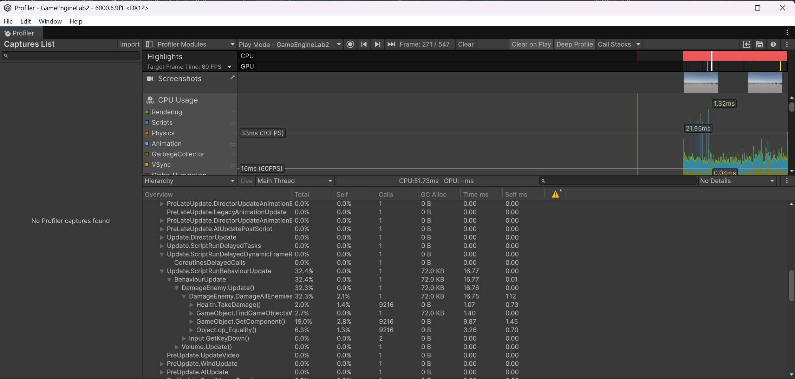
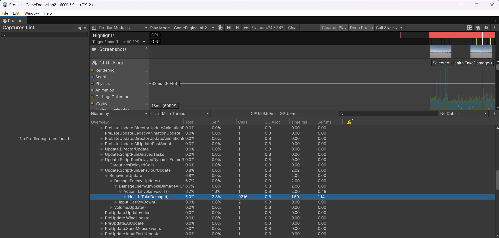

Anson Leung 100748012

For this lab I tried to use observer pattern to improve performance. There are some leftover code with UI stuff but it was interfering with performance too much to see how the observer pattern could help. Also, some of these code is from my last year's game.

The "gameplay loop" is just pressing either 'A' or 'S', the 'A' key just finds every enemy on the scene and finds the health component and does the TakeDamage function. The 'S' Key calls the event to all of the enemies on the scene and also does the TakeDamage function, using the observer pattern.

Without Observer pattern

Without the observer pattern, there is a lot of resources used to getComponent and also looping over all of the gameobjects to see if they match the tag. These all add up because there are about 9216 enemies on the scene, might not happen realistically but just to show how it would impact performance. And everytime it needs to take damage, it has to do the loop over again because in a real game some enemies may already have died so you can't really save all of the same references for next time. This whole process takes about 16.76 ms.

With Observer pattern

With the observer pattern, all enemies will need a reference to the manager and link themselves to the event. The profiler shows the function now only takes 2 ms which is way faster than the previous method. Since every enemy just listens to the manager. The manager does not need to go through each game object anymore, it only needs to call the event and any enemies that are linked to the event will to the TakeDamage function. This shows the Observer pattern can help with one to many objects relationships.

It's probably difficult to see the difference in the build since nothing moves so you can't really see the framerate drop unless you use an external fps counter.
